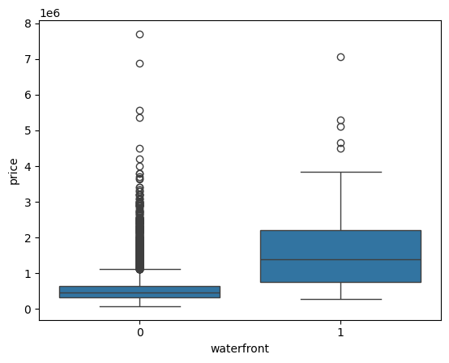
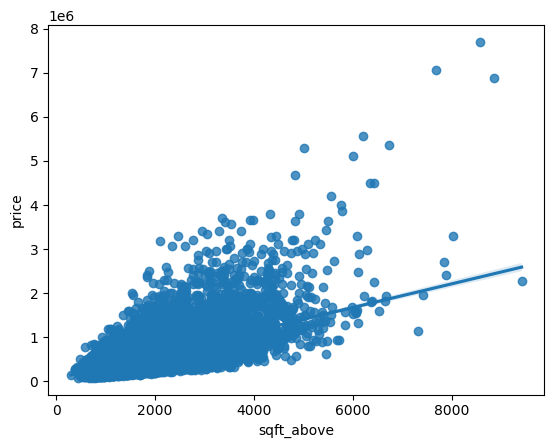
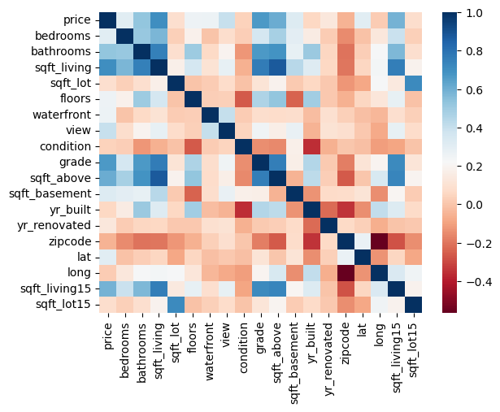

# House Price Analysis: King County, WA

**Course:** Data Analysis with Python (IBM / Coursera), final project, submitted April 8, 2024
**Project score:** 100% (peer-graded) · **Course grade:** 94.6%
**Code:** Jupyter notebook available on request
**Tools:** Python, pandas, NumPy, seaborn, Matplotlib, scikit-learn

## Scenario
Acting as a data analyst for a real estate investment trust, estimate house prices from property attributes. The dataset covers home sales in King County, Washington (including Seattle) between May 2014 and May 2015, a total of **21,613 sales**.

## What I did

### 1. Data preparation
- Reviewed column data types and summary statistics
- Dropped non-analytic columns (`id`, `Unnamed: 0`)
- Found missing values: **13 in `bedrooms`, 10 in `bathrooms`**. Replaced them with each column's mean and confirmed none remained.

### 2. Exploratory analysis
- **Floors:** most homes have 1 floor (10,680) or 2 floors (8,241)
- **Waterfront:** a boxplot compares price distributions for waterfront and non-waterfront homes

  

- **Size vs. price:** a regression plot shows a positive relationship between `sqft_above` and price

  

- **Correlation:** the features most correlated with price were `sqft_living` (0.70), `grade` (0.67) and `sqft_above` (0.61)

  

### 3. Model development and evaluation

| Model | Features | Evaluated on | R² |
|---|---|---|---|
| Linear regression | `long` (longitude) only | Full dataset | 0.0005 |
| Linear regression | `sqft_living` | Full dataset | 0.493 |
| Multiple linear regression | 11 features* | Full dataset | 0.658 |
| Pipeline: scaling + polynomial features + linear regression | 11 features* | Full dataset | 0.751 |
| Ridge regression (α = 0.1) | 11 features* | Test set (15% holdout, 3,242 homes) | 0.648 |
| 2nd-order polynomial + Ridge (α = 0.1) | 11 features* | Test set | **0.700** (train: 0.742) |

\*`floors, waterfront, lat, bedrooms, sqft_basement, view, bathrooms, sqft_living15, sqft_above, grade, sqft_living`

## Findings
- Living area alone explains about half of the variation in price (R² ≈ 0.49).
- Adding more features and polynomial terms raises explanatory power.
- On held-out test data, polynomial Ridge regression reached R² ≈ 0.70. The small gap between train (0.74) and test (0.70) shows limited overfitting.

## Limitations
- The first four R² values were measured on the same data the models were fit on, so they overstate real predictive performance. Only the Ridge models were tested on held-out data.
- Missing values were filled with column means, a simple approach that can understate variability.
- The data covers one county over one year (2014–2015), so the results do not generalize beyond it.

---
*Based on an IBM Skills Network lab template and dataset; the analysis and results are my own work.*
