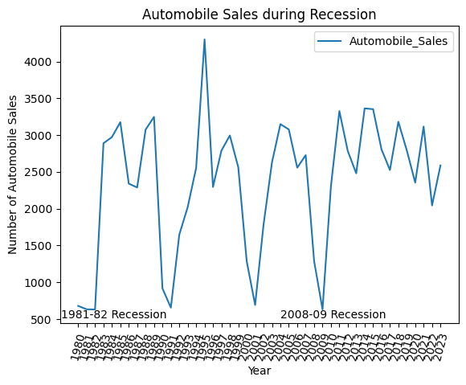
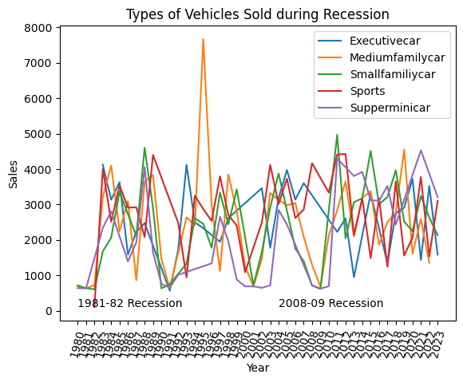
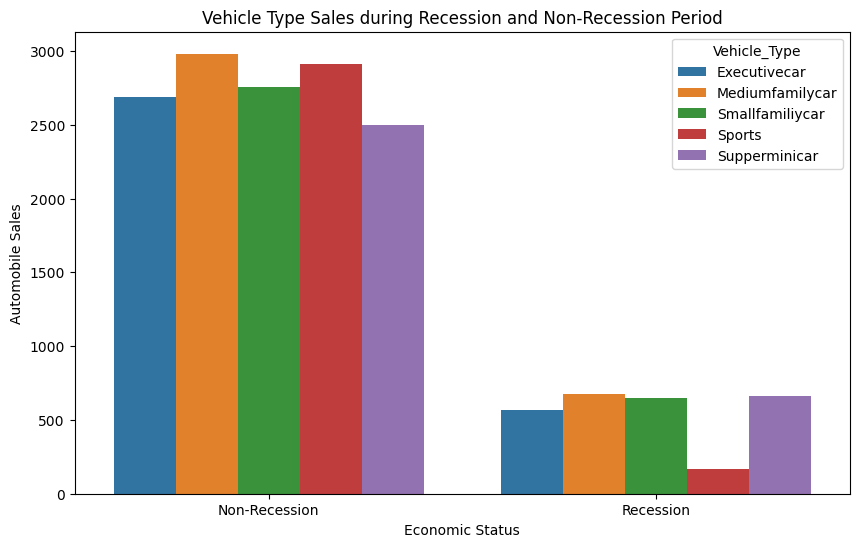
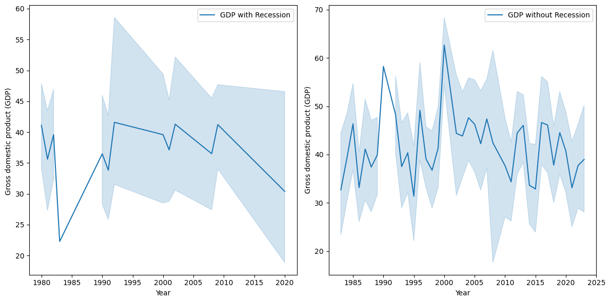
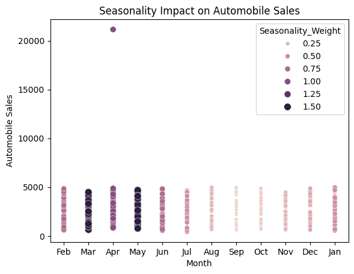
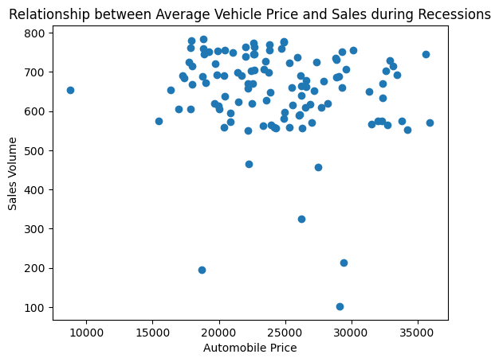
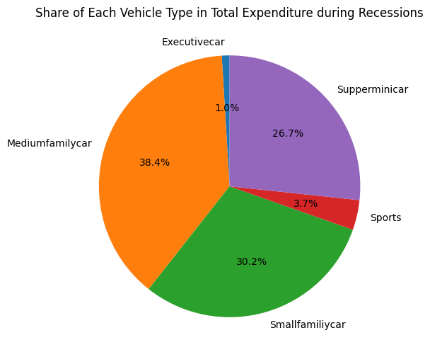
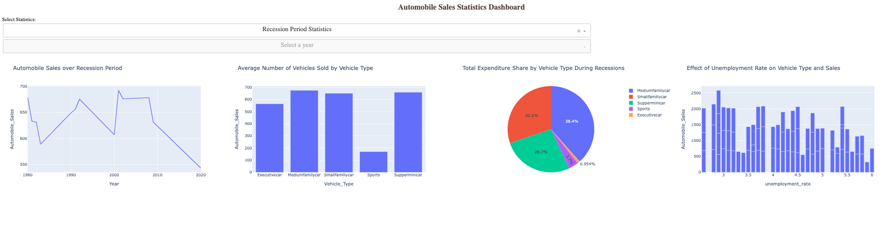
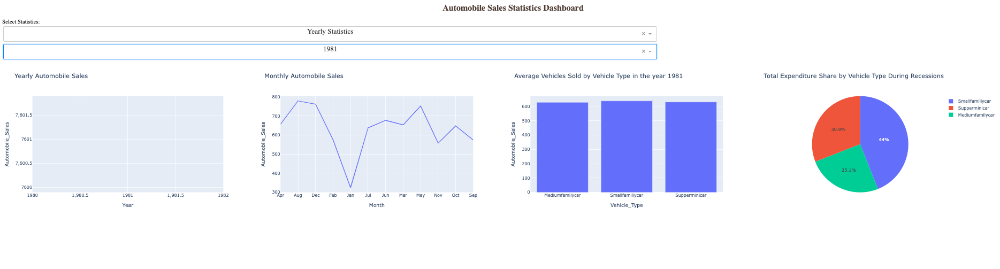

# Automobile Sales During Recessions: Visualization & Interactive Dashboard

**Course:** Data Visualization with Python (IBM / Coursera), final project, April–May 2024
**Course grade:** 98.5%
**Tools:** pandas, Matplotlib, Seaborn, Plotly, Dash

## Scenario
Analyze historical automobile sales data (1980–2023) for a fictional automotive company to see how sales, vehicle mix, advertising spending and economic indicators behaved during recession periods compared with non-recession periods.

## Part 1: Exploratory visualizations

| Chart | Question it answers |
|---|---|
|  | How do automobile sales change from year to year? (1981–82 and 2008–09 recessions labeled) |
|  | Do sales trends differ by vehicle type? |
|  | How do sales by vehicle type compare between recession and non-recession periods? |
|  | How did GDP vary during recession and non-recession periods? |
|  | Does seasonality affect sales? |
|  | Is vehicle price related to sales volume during recessions? |
|  | How was advertising spending split across vehicle types during recessions? |

**My observations (from the notebook):**
- "This bar chart shows a sharp decline in overall automobile sales during recession."
- "From the plot, we see that sales for 'Medium Family' type vehicles sharply declined and then increased during the 2008-09 recession period. 'Super Mini' type vehicle sales remained low during this period and then increased sharply after the recession period."

## Part 2: Interactive dashboard (Plotly Dash)

The dashboard has two dropdowns (report type and year) and a callback that rebuilds four charts depending on what is selected.

**Recession Period Statistics view:** sales over recession periods, average vehicles sold by type, expenditure share by vehicle type, and the effect of the unemployment rate on sales.

**Yearly Statistics view:** yearly and monthly sales, average vehicles sold by type, and expenditure share for the selected year.

## Known issues (found in my own review)
- In the Yearly view, the "Yearly Automobile Sales" chart shows only one year, so it plots a single point and looks empty.
- Months on the "Monthly Automobile Sales" chart appear in data order, not calendar order.
- The Yearly view's pie chart keeps the title "…During Recessions".
- The line charts titled "…during Recession" (Line_Plot_1, Line_Plot_2_1) plot the full 1980–2023 range with recession periods labeled, so the titles overstate what is shown.

## Skills demonstrated
- Grouping and aggregating data in pandas for plotting
- Choosing chart types to fit the question (trend, comparison, composition, relationship)
- Building interactive dashboards with Dash layout components and callbacks
- Reviewing my own output critically against what each chart is supposed to show

---
*Based on an IBM Skills Network lab template and dataset; the analysis and dashboard are my own work. Notebook and dashboard code available on request.*
